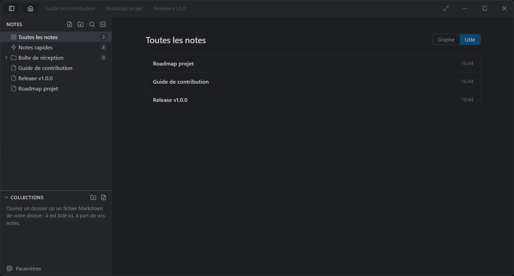

<p align="center">
  <picture>
    <source media="(prefers-color-scheme: dark)" srcset="assets/logotype.svg" width="320" />
    
  </picture>
</p>

<p align="center">
  A fast, keyboard-driven note-taking app for Windows, macOS and Linux.<br />
  Markdown editor, full-text search, folders, tags, backlinks and a graph of your notes — all stored locally.
</p>

<p align="center">
  <a href="https://github.com/getisolated/Daftr/releases/latest">Download</a> ·
  <a href="#features">Features</a> ·
  <a href="#keyboard-shortcuts">Shortcuts</a> ·
  <a href="#sync-between-devices">Sync</a> ·
  <a href="#connect-an-ai-mcp">AI (MCP)</a> ·
  <a href="#upgrading-from-everything-note">Upgrading from Everything Note</a> ·
  <a href="#development">Development</a>
</p>

<p align="center">
  
</p>

> Daftr was previously published as **Everything Note**. Version 1.0.0 renamed the app; see [Upgrading from Everything Note](#upgrading-from-everything-note).

## Install

### Windows

1. Download `Daftr_<version>_x64-setup.exe` from the [latest release](https://github.com/getisolated/Daftr/releases/latest) (Windows 10/11, 64-bit; WebView2 is included in Windows 11).
2. Run it. The installer is signed with a self-signed certificate, so Windows SmartScreen may ask you to confirm the first time.

### macOS

1. Download `Daftr_<version>_aarch64.dmg` from the [latest release](https://github.com/getisolated/Daftr/releases/latest) (Apple Silicon, macOS 13 Ventura or later).
2. Open it and drag **Daftr** into **Applications**.
3. The macOS build is not notarized yet, so the first launch is refused (« Apple could not verify… »). Open **System Settings → Privacy & Security** and click **Open Anyway** (the button appears after that first attempt), or run `xattr -cr /Applications/Daftr.app` once in a terminal.

### Linux

1. From the [latest release](https://github.com/getisolated/Daftr/releases/latest) (x86_64), download:
   - `Daftr_<version>_amd64.deb` on Debian 12, Ubuntu 22.04 or later and their derivatives;
   - `Daftr_<version>_amd64.AppImage` on other distributions (glibc 2.35 or later: Fedora 36…).
2. Install the `.deb` with `sudo apt install ./Daftr_*_amd64.deb` (it also pulls the missing dependencies), or make the AppImage executable (`chmod +x Daftr_*.AppImage`) and run it. Some distributions need `libfuse2` to run AppImages.
3. PDF export is not available on Linux yet; Markdown and HTML exports are.

### Updates and data

Daftr checks for updates at startup and every hour, and offers them in a popup. Turn on **Settings → Automatic Updates** to download them in the background and install them when the app closes. On macOS the updater replaces `Daftr.app` in place, and on Linux the AppImage itself or the `.deb` (reinstalled after asking for your password), so the steps above are needed only once.

Your data stays on your machine: notes live in a SQLite database and settings in a JSON file, both under `%APPDATA%\daftr` on Windows, `~/Library/Application Support/daftr` on macOS and `~/.local/share/daftr` on Linux.

Each [profile](#profiles) has its own database in that folder: the default profile keeps `daftr.db` at its root (the data of before the profiles, untouched), the others live in `profiles/<id>/` (database and icon). `profiles.json` lists them, with the last one opened. The settings (`settings.json`) are shared by every profile.

[Sync](#sync-between-devices) adds a `sync/` folder: `device.key` (the key that identifies this computer, readable by your user only), `devices.json` (the linked devices) and `index.json` (which profile each synced space is). Before its first upgrade to the sync format, each database is backed up next to it as `daftr.db.pre-sync`, and a profile merged with one of another device as `daftr.db.pre-merge-<date>`.

## Features

- **Markdown editor** — CodeMirror 6 with live decorations: headings, bold, italic, code blocks, task lists. `Tab` / `Shift+Tab` on a list item nests it under the previous item or brings it back up, numbered lists being renumbered at both levels. Deleting a numbered item (`Backspace` / `Delete`, line deletion, cut) renumbers the items below it, keeping the number the list starts at, and `Enter` does the same when inserting one; a single undo brings back the item and the former numbers. GFM tables render as real tables and become editable when the caret enters them (`Tab` / `Shift+Tab` between cells, `/table` to insert one, right-click to add / delete rows and columns). Spreadsheet pastes become tables (`Ctrl+Shift+V` pastes the text as is). Multiple cursors like VS Code: `Alt+click` adds a cursor, `Shift+Alt+drag` selects a column, `Ctrl+D` adds the next occurrence to the selection, `Ctrl+Shift+L` selects them all (accents compared exactly, Match Case / Match Whole Word toggles shown above the selection), `Esc` goes back to a single cursor.
- **Preview** — GitHub-like rendering (tables, task lists, footnotes, `> [!NOTE]` alerts, syntax-colored code, Mermaid diagrams). *Source*, *side by side* with synchronized scrolling, or *Preview*; notes can open rendered by default.
- **Full-text search** — instant search across every note (SQLite FTS5), from the command palette (`Ctrl+Shift+F`). Find & replace inside a note (`Ctrl+F` / `Ctrl+H`) with match case, whole word and regular expressions, and the list of matches.
- **Command palette** — `F1` to search notes, commands and tags.
- **Folders** — a VS Code-like tree: create, rename, delete, drag & drop notes and folders, multi-select (`Ctrl+click` / `Shift+click`), *Move To…*, *Empty*, a color per folder. Hover a folder for its **+** button: a new note right in that folder. Double-click the empty area of the tree for a new note. New notes land in `Inbox`.
- **Tags** — organize notes with tags and filter from the sidebar.
- **Backlinks & graph** — link notes with `[label](Folder/Note title)` (autocompleted) or `note://ID`. A panel under the editor lists the notes linking to the active one; the home page draws an Obsidian-like graph of all links (zoom, pan, drag, click to open, colored by folder). `Ctrl+click` follows a link.
- **Collections** — open folders of markdown files from your disk (a repository's docs, for instance) next to your notes. Hover a folder (or the collection itself) for its **+** button: a new `.md` file right in it. Files open in tabs, save to disk, reload when changed by another program, and are found by the palette search. Right-click a file, a folder or a multi-selection (`Ctrl+click` / `Shift+click`) and *Copy To…* to copy them into your notes, folder structure included: each note is titled after its file, and the links between the copied files keep working. Links to a chapter (`#heading`, `guide.md#heading`) scroll to it, in the source (`Ctrl+click`) as in the preview. `.md` files open with Daftr from the Explorer or the Finder.
- **Tabs** — drag & drop reordering, pinning, session restore.
- **Zen mode** — `Ctrl+K` `Z` hides the tabs, the outline and the sidebar. The sidebar then floats tucked away on the left edge and slides in when the pointer reaches it (or with `Ctrl+Shift+E`). With **Settings → Zen Mode Always on Top**, the window stays above the other applications while in zen mode.
- **Formatting bar** — a Word-like toolbar reflecting the formatting under the caret. `Alt+T` toggles it; size, style and position are settings.
- **Quick-note overlay** — a global shortcut (`Ctrl+Alt+Q` by default, `⌥⌘Q` on macOS) pops a small always-on-top window anywhere on screen. Notes sent from it are gathered in a single *Quick notes* document, where each one can be copied, edited, deleted or converted into a regular note (filed in *Inbox* if it has no folder).
- **Copy & export** — copy a note as markdown, export it as Markdown, standalone HTML or PDF (Windows and macOS; A4 pages, rendered like the preview: tables, colored code, Mermaid diagrams). Export a folder, or a multi-selection of notes and folders, as a ZIP of `.md` files or of PDF files.
- **Themes** — Dark (default), Light, GitHub Light, Solarized Light, Violet Light, GitHub Dark Dimmed, or *System* following the OS. `Ctrl+K Ctrl+T` previews them live.
- **Settings** — a VS Code-like settings editor (`Ctrl+,`) with search, categories and reset to default. Every shortcut can be rebound there.
- **System tray / menu bar** — closing the window keeps Daftr running in the tray; optional launch at Windows startup. On macOS it stays in the Dock and the menu bar (`⇧⌘W` closes the window the same way), `⌘Q` quits, and *Launch at login* is optional; the menu bar icon can be turned off in Settings (Daftr keeps running in the Dock).
- **Languages** — English and French; the first launch follows the OS locale.
- **Profiles** — separate sets of notes, folders and collections (work, personal…), each with an optional name, a round icon (any image, cropped and resized) and an optional master password asked when it opens. Hover the profile item above **Settings** in the sidebar to switch, create or configure a profile. Right-click a note, a folder, a multi-selection or a collection and *Transfer to Profile* to move them to another profile. Settings, themes and shortcuts are shared. See [Profiles](#profiles).
- **Sync between devices** — your computers sync their notes in real time while they are on the same local network, with no server, no account and nothing going through the Internet. Link two devices once with a 6-digit code (or `IP:port`), then switch on what each one receives, profiles and folder collections; edits made on both sides merge by themselves, character by character. See [Sync between devices](#sync-between-devices).
- **MCP server (AI access)** — an optional local [MCP](https://modelcontextprotocol.io) server lets AI assistants (Claude Code, Claude Desktop, Cursor…) list, search, read, create and edit your notes. It only listens on `127.0.0.1`, requires an access token, and cannot delete notes; notes written by an AI show up in the app at once. See [Connect an AI (MCP)](#connect-an-ai-mcp).

## Keyboard shortcuts

Every shortcut below is a default and can be rebound in **Settings → Keyboard Shortcuts**.

| Windows                              | macOS                        | Action |
| ------------------------------------ | ---------------------------- | ------ |
| `F1`                                 | `F1`                         | Command palette |
| `Ctrl+N`                             | `⌘N`                         | New note |
| `Ctrl+S`                             | `⌘S`                         | Save note |
| `Ctrl+W`                             | `⌘W`                         | Close tab |
| `Ctrl+Tab` / `Ctrl+Shift+Tab`        | `⌃⇥` / `⌃⇧⇥`                 | Next / previous tab |
| `Alt+Ctrl+1-9`                       | `⌥⌘1-9`                      | Jump to tab by index |
| `Alt+P`                              | `⌥P`                         | Pin / unpin tab |
| `Ctrl+Shift+F`                       | `⇧⌘F`                        | Search all notes |
| `Ctrl+F` / `Ctrl+H`                  | `⌘F` / `⌥⌘F`                 | Find / find & replace in the note |
| `Ctrl+B` / `Ctrl+I` / `Ctrl+Shift+K` | `⌘B` / `⌘I` / `⇧⌘K`          | Bold / italic / link |
| `Ctrl+Shift+V`                       | `⇧⌘V`                        | Paste as plain text (no conversion to a table) |
| `Ctrl+Shift+D`                       | `⇧⌘D`                        | Toggle a draft block |
| `Ctrl+D`                             | `⌘D`                         | Add the next occurrence to the selection |
| `Ctrl+Shift+L`                       | `⇧⌘L`                        | Select every occurrence of the selection |
| `Alt+click` / `Shift+Alt+drag`       | `⌥click` / `⇧⌥drag`          | Add a cursor / column selection |
| `Ctrl+K` `P` (chord)                 | `⌘K` `P` (chord)             | Toggle the preview |
| `Ctrl+K` `V` (chord)                 | `⌘K` `V` (chord)             | Toggle the side-by-side preview |
| `Ctrl+Shift+E`                       | `⇧⌘E`                        | Toggle the sidebar |
| `Alt+T`                              | `⌥T`                         | Toggle the formatting bar |
| `Alt+Z`                              | `⌥Z`                         | Toggle line wrap |
| `Alt+W`                              | `⌥W`                         | Toggle wide mode |
| `Ctrl+K` `Z` (chord)                 | `⌘K` `Z` (chord)             | Toggle zen mode |
| `Ctrl+K` `Ctrl+T` (chord)            | `⌘K` `⌘T` (chord)            | Theme picker (live preview) |
| `Ctrl+,`                             | `⌘,`                         | Settings |
| `Ctrl+Alt+Q` (global, configurable)  | `⌥⌘Q` (global, configurable) | Toggle the quick-note overlay |

On macOS, `⌘` replaces `Ctrl` and `⌥` replaces `Alt`, with two exceptions: tabs cycle with `⌃⇥` (`⌘Tab` is the system app switcher) and find & replace is `⌥⌘F` (`⌘H` hides the app). In the search panel, *replace all* is `⌥⌘↩`.

On macOS the global shortcut is bound to the physical key position. Until it has been recorded once, Daftr assumes an AZERTY keyboard: the default `⌥⌘Q` is the key labelled Q on an AZERTY layout, which is `⌥⌘A` on a QWERTY one. Recording the shortcut again in **Settings** binds the right key for any layout.

In the overlay: `Enter` sends (`Shift+Enter` = new line) — or, if configured, `Enter` = new line and `Ctrl+Enter` (`⌘↩` on macOS) sends. `Esc` or a click outside hides it; the draft is kept.

## Profiles

Daftr starts on the last profile used. The first one, the *default profile*, holds the notes of before the profiles: nothing is moved on update.

- **Switch** — hover (or click) the profile item at the bottom of the sidebar: the menu lists the profiles, the current one checked. Picking another one saves the edits in progress and reloads the window on its notes, tabs and sidebar state (each profile remembers its own).
- **New profile** — opens its settings; once saved, the new profile (an empty `Inbox`) opens.
- **Profile settings** — name, icon (an image cropped to its centred square and resized to 256 px), master password (set, change or remove it; the current one is asked to change or remove it). The settings dialog also deletes the profile (its data goes to the trash). Deleting the open one opens another profile in its place; the default profile cannot disappear: it starts again empty.
- **Master password** — a protected profile shows a lock screen at launch, before any of its data is read; another profile can be opened from there. The password is never stored, only its salted Argon2id hash. **The notes are not encrypted**: the password locks the profile in Daftr, not the files on the disk.
- **Transfer** — *Transfer to Profile* moves notes, folders (with their sub-folders) and collections to another profile. The items are first copied into the other profile, then deleted here: if the copy fails, nothing is lost. Single notes land in its *Inbox*, folders at its root; a collection only moves its entry (its files stay where they are). Transferring to a protected profile does not ask its password.
- **AI access (MCP)** and the **quick-note overlay** always work on the current profile; while it is locked, the AI gets an error and the quick-note shortcut shows the lock screen.

## Sync between devices

Daftr syncs your notes between your own computers **over the local network only**: no server, no account, nothing goes through the Internet, and connections from or to an address outside the local network are refused. Two devices sync while they are on, on the same network; changes made in between wait and leave as soon as they meet again. Settings and themes are not synced; folder collections sync only if you share them (below).

1. **Link the devices, once.** Open **Synchronization** (the profile menu, the *N collections to set up* row of the Collections section, or **Settings → Sync → Open Synchronization**). The right side always shows a 6-digit code and a QR code, valid 5 minutes and renewed by themselves. On the other device, open Synchronization too, choose **Enter a code** and type the six digits (paste works, spaces are ignored). On networks that hide devices from each other (some Wi-Fi or company networks), also type the IP address shown under the code. The code is checked without ever being sent, and a new one is drawn after 10 wrong attempts. Linking only makes the two devices trust each other: nothing is shared yet, and both can then share with the other.
2. **Switch on what to share.** The left side is a table: a row for the profile and one per folder collection of the selected profile, a column of switches per linked device. Switching a profile on gives the other device a **copy of it**, with no question asked (same name and icon; a profile with a master password is shared too, but the password is not sent: the copy has none). It shows a notice *Profile “X” received from A* with **Switch**, which opens that profile. Switching a collection on offers it: the other device sees it as a **To set up** row (a dashed border) and nothing is written to its disk until it picks the profile and the folder and chooses **Activate** (a folder that already holds notes is merged); **Ignore** refuses it. A dot on the profile item and on **Synchronization…** in its menu tells that collections are still to set up.
3. **Then it is automatic.** A note edited on one device shows up on the other within seconds, whatever profile is open on each side, locked ones included. Edits made on both sides merge by themselves, with no conflict dialog; the open note gets them without losing what you are typing, with a *Changed on <device>* badge.

- **Collections** — right-click a folder collection → **Sync with…** to switch on the devices that receive it, without opening Synchronization. Only the `.md` files are shared (never the other files of the folder); a deleted file goes to the recycle bin of the other device; a file changed on both sides is kept twice (`name (conflit <device>).md`) with a banner to keep one version or compare.
- **Devices** — in Synchronization, each linked device shows its icon (laptop or desktop), its name and the start of its key (e.g. `4F2A-9C1B`) to tell two devices of the same name apart. A third device linked to a single one of them gets everything through it.
- **Pause** — **Settings → Sync → Pause** stops everything (no listening, no connection); your changes leave when you resume. **Sync Now** retries at once. The sync screen header shows the state (up to date, syncing, no device on this network, paused, error with its cause); the sidebar only shows a row above the profile item for a problem (no device on this network, error).
- **Remove a device** — **Remove Device** in the Devices list of Synchronization stops it for every profile and collection, for good: linking it again takes a new code. **The notes already copied to that device stay there.**
- **Port** — TCP `47820` by default (**Settings → Sync → Port**), plus mDNS (UDP `5353`) to find the devices.

Firewall:

- **Windows** — the installer adds the firewall rules (TCP 47820 and UDP 5353, for Daftr only, on *Private* networks), after a single administrator prompt. Mark your network as **Private** (**Settings → Network & Internet → Wi-Fi / Ethernet → Network profile type**): on a *Public* network Windows blocks the sync and the indicator says so. If you change the port, allow the new one yourself.
- **macOS** — accept the **Local Network** request the first time (or later in **System Settings → Privacy & Security → Local Network**): without it macOS silently blocks the sync.
- **Linux** — nothing to do without a firewall. With ufw or firewalld, open the sync port and mDNS:
  ```bash
  # ufw
  sudo ufw allow 47820/tcp
  sudo ufw allow 5353/udp
  # firewalld
  sudo firewall-cmd --permanent --add-port=47820/tcp --add-service=mdns
  sudo firewall-cmd --reload
  ```

## Connect an AI (MCP)

1. Open **Settings → AI (MCP)** and turn on **MCP Server**. Daftr generates an access token and starts the server on `http://127.0.0.1:38427/mcp` (the port can be changed there; the status line tells if it is already taken).
2. Copy the snippet for your client from the same page:
   - **Claude Code**: run the command in a terminal:
     ```bash
     claude mcp add --transport http daftr http://127.0.0.1:38427/mcp --header "Authorization: Bearer <token>"
     ```
   - **Claude Desktop** (needs Node.js): add the entry to `claude_desktop_config.json`, then restart Claude Desktop. It goes through [`mcp-remote`](https://www.npmjs.com/package/mcp-remote):
     ```json
     {
       "mcpServers": {
         "daftr": {
           "command": "npx",
           "args": ["-y", "mcp-remote", "http://127.0.0.1:38427/mcp", "--header", "Authorization:${AUTH_HEADER}"],
           "env": { "AUTH_HEADER": "Bearer <token>" }
         }
       }
     }
     ```
   - **Other clients** (Cursor…): a Streamable HTTP server at the same URL with the header `Authorization: Bearer <token>`.
3. Ask away: *"Summarize my notes tagged meeting"*, *"Add today's decisions to my Project X note"*.

Tools: `list_folders`, `list_notes`, `search_notes`, `get_note`, `list_tags`, `create_note` (into Inbox by default), `update_note`, `append_to_note`. There is no delete tool, and collections (folders of markdown files) are not exposed. **Regenerate** the token to disconnect every configured client. Daftr must be running for the AI to reach your notes.

## Upgrading from Everything Note

Install Daftr over your current version (the in-app updater offers it, or run the installer from the [latest release](https://github.com/getisolated/Daftr/releases/latest)). Nothing to do by hand:

- the installer silently removes the previous *Everything Note* installation, Electron (0.0.11 and earlier) or Tauri (0.0.12);
- on first launch, your notes, settings and collections are moved from `%APPDATA%\everything-note` to `%APPDATA%\daftr`;
- theme, open tabs, sidebar layout and other UI preferences carry over.

## Development

Daftr is an Angular frontend inside a Tauri 2 (Rust) shell, with SQLite for storage.

| Layer | Technology |
|-------|-----------|
| Frontend | Angular 22 (standalone components, signals, OnPush) |
| Editor | CodeMirror 6 with custom markdown decorations |
| Desktop | Tauri 2 (Rust, WebView2 on Windows, WKWebView on macOS, WebKitGTK on Linux), frameless window with a custom title bar on Windows and Linux, native traffic lights over the tab bar on macOS |
| Database | SQLite (rusqlite, bundled) with FTS5, WAL mode, cached prepared statements |
| Bindings | Rust → TypeScript types generated by ts-rs (`frontend/src/app/core/bindings`) |
| Build | Tauri bundler (NSIS installer on Windows, DMG on macOS, AppImage and `.deb` on Linux), GitHub Actions CI/CD |

### Prerequisites

- Node.js 24+ and npm
- Rust stable (1.90+)
- Windows: the MSVC toolchain and WebView2 (included in Windows 11)
- macOS: Xcode Command Line Tools (`xcode-select --install`)
- Linux (Debian / Ubuntu): `sudo apt install libwebkit2gtk-4.1-dev libayatana-appindicator3-dev librsvg2-dev libxdo-dev libssl-dev build-essential`

### Run, test, build

```bash
# Install dependencies (npm workspaces: the root holds the Tauri CLI, frontend/ the Angular app)
npm install

# Development mode (Angular dev server + Tauri window, Rust rebuilt on change)
npm run dev

# Tests: Angular (vitest) and Rust (also regenerates the TypeScript bindings)
npm test
npm run test:rust

# Release build: Angular + Rust, then the installer
# Windows: src-tauri/target/release/bundle/nsis — macOS: bundle/dmg and bundle/macos in the same folder
# The update signature needs the private key: TAURI_SIGNING_PRIVATE_KEY (path or content)
npm run build
```

### Layout

```
src-tauri/                   # Rust workspace
  crates/
    platform/                # Generic base: logging, poison-tolerant locks, canonical paths
    domain/                  # Pure rules (std only): settings validation, overlay geometry, collection links/graph/search, export names, i18n, profile registry, transfer plan
    app/                     # Use cases (notes, folders, collections, settings, export, profiles, transfer) and their ports (traits)
    adapter-sqlite/          # SQLite store: schema, idempotent migrations, FTS5 triggers, queries, transfer import
    adapter-fs/              # settings.json, profiles.json and profile folders, collection files, Recycle Bin, ZIP export, scan/watch/search thread
    adapter-password/        # Master passwords of the profiles: salted Argon2id hashes
    adapter-mcp/             # Local MCP server (rmcp, Streamable HTTP on 127.0.0.1, bearer token): the AI tools on notes
    adapter-print/           # PDF export: a hidden window prints the page natively (WKWebView / WebView2), the only `unsafe` code
    presentation/            # DTOs exported to TypeScript (ts-rs), IPC errors, event names
    desktop/                 # Tauri shell: IPC commands, main + overlay windows, tray, global shortcut, autostart, updater
      tauri.conf.json        # Bundle, updater endpoint and public key, NSIS hook (removes the Everything Note versions)
      tauri.macos.conf.json  # macOS overrides: DMG bundle, minimum macOS 13
      capabilities/          # Window permissions granted to the renderer

scripts/
  macos-*.swift              # Regenerate the .icns icon, the menu bar icon and the DMG background

frontend/src/app/
  core/
    i18n/                    # I18nService, pure translate(), typed en/fr dictionaries per area
    services/                # Notes, folders, tabs, backlinks, palette, shortcuts, theme, sidebar state
    models/                  # TypeScript interfaces (Note, Folder, Tab, PaletteItem, shortcuts, themes)
    utils/                   # Pure helpers (folder tree, note links, storage migration)
  features/                  # editor, preview, find, backlinks, graph, sidebar, home, tabs, palette, overlay, settings, formatting-bar, profiles
  shared/
    codemirror/              # Highlight style, markdown decorations, widgets, link navigation
    context-menu/            # Reusable context menu component
    ui/                      # Themed checkbox, select, confirm dialog, row "+" button, focus-select directive
```

### Releases

Every merge on `main` publishes a release (`.github/workflows/release.yml`). The version is computed from the commits since the last `vX.Y.Z` tag following [Conventional Commits](https://www.conventionalcommits.org/): `type!:` / `BREAKING CHANGE` bumps the major, `feat:` the minor, anything else the patch. A squash-merged PR counts as one commit whose title is the PR title, so **the PR title decides the bump**. The CI checks (Angular tests, `cargo fmt`, `clippy`, Rust tests, on Windows, macOS and Linux) must pass first.

Three jobs build the app: `build-windows` (NSIS installer), `build-macos` (Apple Silicon DMG and the updater archive) and `build-linux` (x86_64 AppImage and `.deb`, also the updater artifacts). Each produces its artifacts and their signatures. The `release` job then merges them into a single `latest.json` (`windows-x86_64`, `darwin-aarch64` and `linux-x86_64` and `linux-x86_64-deb` entries) that the app queries to offer updates. If one platform fails, the whole release is blocked.

For the secrets and the update manifest, see the header comments of `.github/workflows/release.yml` and `scripts/update-manifest.mjs`.

## License

MIT
