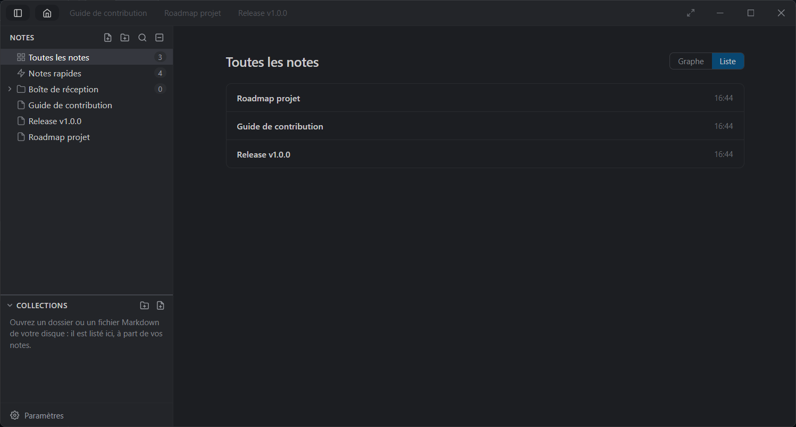

<p align="center">
  <picture>
    <source media="(prefers-color-scheme: dark)" srcset="assets/logotype.svg" width="320" />
    
  </picture>
</p>

<p align="center">
  A fast, keyboard-driven note-taking app for Windows.<br />
  Markdown editor, full-text search, folders, tags, backlinks and a graph of your notes — all stored locally.
</p>

<p align="center">
  <a href="https://github.com/getisolated/Daftr/releases/latest">Download</a> ·
  <a href="#features">Features</a> ·
  <a href="#keyboard-shortcuts">Shortcuts</a> ·
  <a href="#upgrading-from-everything-note">Upgrading from Everything Note</a> ·
  <a href="#development">Development</a>
</p>

<p align="center">
  
</p>

> Daftr was previously published as **Everything Note**. Version 1.0.0 renamed the app; see [Upgrading from Everything Note](#upgrading-from-everything-note).

## Install

1. Download `Daftr_<version>_x64-setup.exe` from the [latest release](https://github.com/getisolated/Daftr/releases/latest) (Windows 10/11, 64-bit; WebView2 is included in Windows 11).
2. Run it. The installer is signed with a self-signed certificate, so Windows SmartScreen may ask you to confirm the first time.

Daftr then checks for updates at startup and every hour, and offers them in a popup. Turn on **Settings → Automatic Updates** to download them in the background and install them when the app closes.

Your data stays on your machine: notes live in a SQLite database and settings in a JSON file, both under `%APPDATA%\daftr`.

## Features

- **Markdown editor** — CodeMirror 6 with live decorations: headings, bold, italic, code blocks, task lists. GFM tables render as real tables and become editable when the caret enters them (`Tab` / `Shift+Tab` between cells, `/table` to insert one, right-click to add / delete rows and columns). Spreadsheet pastes become tables.
- **Preview** — GitHub-like rendering (tables, task lists, footnotes, `> [!NOTE]` alerts, syntax-colored code, Mermaid diagrams). *Source*, *side by side* with synchronized scrolling, or *Preview*; notes can open rendered by default.
- **Full-text search** — instant search across every note (SQLite FTS5), from the command palette (`Ctrl+Shift+F`). Find & replace inside a note (`Ctrl+F` / `Ctrl+H`) with match case, whole word and regular expressions, and the list of matches.
- **Command palette** — `F1` to search notes, commands and tags.
- **Folders** — a VS Code-like tree: create, rename, delete, drag & drop notes and folders, multi-select (`Ctrl+click` / `Shift+click`), *Move To…*, *Empty*, a color per folder. New notes land in `Inbox`.
- **Tags** — organize notes with tags and filter from the sidebar.
- **Backlinks & graph** — link notes with `[label](Folder/Note title)` (autocompleted) or `note://ID`. A panel under the editor lists the notes linking to the active one; the home page draws an Obsidian-like graph of all links (zoom, pan, drag, click to open, colored by folder). `Ctrl+click` follows a link.
- **Collections** — open folders of markdown files from your disk (a repository's docs, for instance) next to your notes. Files open in tabs, save to disk, reload when changed by another program, and are found by the palette search. `.md` files open with Daftr from the Explorer.
- **Tabs** — drag & drop reordering, pinning, session restore.
- **Formatting bar** — a Word-like toolbar reflecting the formatting under the caret. `Alt+T` toggles it; size, style and position are settings.
- **Quick-note overlay** — a global shortcut (`Ctrl+Alt+Q` by default) pops a small always-on-top window anywhere on screen. Notes sent from it are gathered in a single *Quick notes* document, where each one can be copied, edited or deleted.
- **Copy & export** — copy a note as markdown, export it as Markdown or standalone HTML, export a folder as a ZIP of `.md` files.
- **Themes** — Dark (default), Light, GitHub Light, Solarized Light, Violet Light, GitHub Dark Dimmed, or *System* following Windows. `Ctrl+K Ctrl+T` previews them live.
- **Settings** — a VS Code-like settings editor (`Ctrl+,`) with search, categories and reset to default. Every shortcut can be rebound there.
- **System tray** — closing the window keeps Daftr running in the tray; optional launch at Windows startup.
- **Languages** — English and French; the first launch follows the OS locale.

## Keyboard shortcuts

Every shortcut below is a default and can be rebound in **Settings → Keyboard Shortcuts**.

| Shortcut | Action |
|----------|--------|
| `F1` | Command palette |
| `Ctrl+N` | New note |
| `Ctrl+S` | Save note |
| `Ctrl+W` | Close tab |
| `Ctrl+Tab` / `Ctrl+Shift+Tab` | Next / previous tab |
| `Alt+Ctrl+1-9` | Jump to tab by index |
| `Alt+P` | Pin / unpin tab |
| `Ctrl+Shift+F` | Search all notes |
| `Ctrl+F` / `Ctrl+H` | Find / find & replace in the note |
| `Ctrl+B` / `Ctrl+I` / `Ctrl+Shift+K` | Bold / italic / link |
| `Ctrl+Shift+V` | Toggle the preview |
| `Ctrl+K` `V` (chord) | Toggle the side-by-side preview |
| `Ctrl+Shift+E` | Toggle the sidebar |
| `Alt+T` | Toggle the formatting bar |
| `Alt+Z` | Toggle line wrap |
| `Alt+W` | Toggle wide mode |
| `Ctrl+K` `Ctrl+T` (chord) | Theme picker (live preview) |
| `Ctrl+,` | Settings |
| `Ctrl+Alt+Q` (global, configurable) | Toggle the quick-note overlay |

In the overlay: `Enter` sends (`Shift+Enter` = new line) — or, if configured, `Enter` = new line and `Ctrl+Enter` sends. `Esc` or a click outside hides it; the draft is kept.

## Upgrading from Everything Note

Install Daftr over your current version (the in-app updater offers it, or run the installer from the [latest release](https://github.com/getisolated/Daftr/releases/latest)). Nothing to do by hand:

- the installer silently removes the previous *Everything Note* installation, Electron (0.0.11 and earlier) or Tauri (0.0.12);
- on first launch, your notes, settings and collections are moved from `%APPDATA%\everything-note` to `%APPDATA%\daftr`;
- theme, open tabs, sidebar layout and other UI preferences carry over.

## Development

Daftr is an Angular frontend inside a Tauri 2 (Rust) shell, with SQLite for storage.

| Layer | Technology |
|-------|-----------|
| Frontend | Angular 22 (standalone components, signals, OnPush) |
| Editor | CodeMirror 6 with custom markdown decorations |
| Desktop | Tauri 2 (Rust, WebView2), frameless window, custom title bar |
| Database | SQLite (rusqlite, bundled) with FTS5, WAL mode, cached prepared statements |
| Bindings | Rust → TypeScript types generated by ts-rs (`frontend/src/app/core/bindings`) |
| Build | Tauri bundler (NSIS installer), GitHub Actions CI/CD |

### Prerequisites

- Node.js 24+ and npm
- Rust stable (1.90+), with the MSVC toolchain
- WebView2 (included in Windows 11)

### Run, test, build

```bash
# Install dependencies (npm workspaces: the root holds the Tauri CLI, frontend/ the Angular app)
npm install

# Development mode (Angular dev server + Tauri window, Rust rebuilt on change)
npm run dev

# Tests: Angular (vitest) and Rust (also regenerates the TypeScript bindings)
npm test
npm run test:rust

# Release build: Angular + Rust, then the NSIS installer (src-tauri/target/release/bundle/nsis)
# The update signature needs the private key: TAURI_SIGNING_PRIVATE_KEY (path or content)
npm run build
```

### Layout

```
src-tauri/                   # Rust workspace
  crates/
    platform/                # Generic base: logging, poison-tolerant locks, canonical paths
    domain/                  # Pure rules (std only): settings validation, overlay geometry, collection links/graph/search, export names, i18n
    app/                     # Use cases (notes, folders, collections, settings, export) and their ports (traits)
    adapter-sqlite/          # SQLite store: schema, idempotent migrations, FTS5 triggers, queries
    adapter-fs/              # settings.json, collection files, Recycle Bin, ZIP export, scan/watch/search thread
    presentation/            # DTOs exported to TypeScript (ts-rs), IPC errors, event names
    desktop/                 # Tauri shell: IPC commands, main + overlay windows, tray, global shortcut, autostart, updater
      tauri.conf.json        # Bundle, updater endpoint and public key, NSIS hook (removes the Everything Note versions)
      capabilities/          # Window permissions granted to the renderer

frontend/src/app/
  core/
    i18n/                    # I18nService, pure translate(), typed en/fr dictionaries per area
    services/                # Notes, folders, tabs, backlinks, palette, shortcuts, theme, sidebar state
    models/                  # TypeScript interfaces (Note, Folder, Tab, PaletteItem, shortcuts, themes)
    utils/                   # Pure helpers (folder tree, note links, storage migration)
  features/                  # editor, preview, find, backlinks, graph, sidebar, home, tabs, palette, overlay, settings, formatting-bar
  shared/
    codemirror/              # Highlight style, markdown decorations, widgets, link navigation
    context-menu/            # Reusable context menu component
    ui/                      # Themed checkbox, select, confirm dialog, focus-select directive
```

### Releases

Every merge on `main` publishes a release (`.github/workflows/release.yml`). The version is computed from the commits since the last `vX.Y.Z` tag following [Conventional Commits](https://www.conventionalcommits.org/): `type!:` / `BREAKING CHANGE` bumps the major, `feat:` the minor, anything else the patch. A squash-merged PR counts as one commit whose title is the PR title, so **the PR title decides the bump**. The CI checks (Angular tests, `cargo fmt`, `clippy`, Rust tests) must pass first. Details, secrets and the update manifest: [docs/dev/internals.md](docs/dev/internals.md#releases).

### Further reading

- [docs/dev/internals.md](docs/dev/internals.md) — identity and data folders, legacy migration, themes, shortcuts, i18n, editor and collections internals, auto-update, releases.
- [docs/dev/migration-tauri.md](docs/dev/migration-tauri.md) — the Electron → Rust + Tauri migration (French).
- [docs/releases/](docs/releases/) — release notes.

## License

MIT
